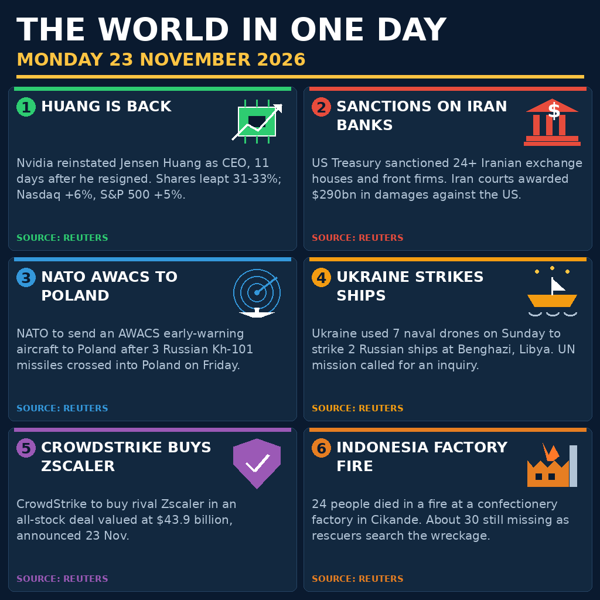

[](https://make.fun/bounty/news-image-20261123?utm_source=github&utm_medium=readme&utm_campaign=news-image-20261123)
[](https://make.fun/bounty/news-image-20261123/leaderboard?utm_source=github&utm_medium=readme&utm_campaign=news-image-20261123)
[](https://make.fun/bounty/news-image-20261123?utm_source=github&utm_medium=readme&utm_campaign=news-image-20261123)
# The World in One Day — Monday 23 November 2026

This is an entry for the make.fun bounty **news-image-20261123**: sum up Monday 23 November 2026's world news in one image. Six verified stories are drawn in a single 1024x1024 PNG, created entirely in code with Python and Pillow — no AI-generated imagery.



## The six stories

1. **Huang is back** — Nvidia reinstated Jensen Huang as CEO, 11 days after he resigned; shares leapt 31-33%, Nasdaq rose 6% and the S&P 500 rose 5%.
2. **Sanctions on Iran banks** — The US Treasury sanctioned more than two dozen Iranian exchange houses, front companies and staff; Iranian courts awarded $290bn in damages against the US.
3. **NATO AWACS to Poland** — NATO agreed to send an AWACS early-warning aircraft to Poland after three Russian Kh-101 cruise missiles crossed into Poland on Friday.
4. **Ukraine strikes ships** — Ukraine used seven naval drones on Sunday to strike two Russian ships at Benghazi, Libya; the UN mission in Libya called for an independent investigation.
5. **CrowdStrike buys Zscaler** — CrowdStrike said on 23 Nov it would buy rival Zscaler in an all-stock deal valued at $43.9 billion.
6. **Indonesia factory fire** — 24 people died in a fire at a confectionery factory in Cikande, Indonesia; about 30 people are still missing as rescuers search the wreckage.

## Run it

```bash
python3 make_image.py
MAKEFUN_OUTPUT_DIR=out python3 main.py
```

`make_image.py` draws `news.png` from scratch with Pillow. `main.py` validates the PNG (signature, 1024x1024, at most 1 MiB) and copies it byte-for-byte to `$MAKEFUN_OUTPUT_DIR/entry.png`.

## License

MIT — see [LICENSE](LICENSE).
